# Database Design (ERD)

PostgreSQL via Prisma. All money is stored as `Int` **poisha** (৳1 = 100). Primary keys are `cuid`. Every table has `createdAt` and `updatedAt`. Soft-deletion (archiving) is used for products, variants, categories and collections, so that past orders and reports stay intact.

## 1. Entity-relationship diagram

```mermaid
erDiagram
  User ||--o| CustomerProfile : has
  User ||--o{ Address : saves
  User ||--o{ Session : has
  User ||--o{ Order : places
  User ||--o{ Review : writes
  User ||--o{ WishlistItem : saves
  User ||--o| Cart : owns
  User ||--o{ AuditLog : performs

  Category ||--o{ Category : "parent of"
  Category ||--o{ Product : contains
  FragranceFamily ||--o{ ProductFamily : ""
  Product ||--o{ ProductFamily : "tagged with"
  Product ||--o{ ProductVariant : "sold as"
  Product ||--o{ ProductImage : shows
  Product ||--o{ ProductNote : has
  FragranceNote ||--o{ ProductNote : ""
  Product ||--o{ ProductOccasion : suits
  Occasion ||--o{ ProductOccasion : ""
  Product ||--o{ ProductSeason : suits
  Product ||--o{ ProductTranslation : "localised as"
  Collection ||--o{ CollectionProduct : includes
  Product ||--o{ CollectionProduct : ""

  ProductVariant ||--|| Inventory : "stock of"
  ProductVariant ||--o{ InventoryMovement : logs
  ProductVariant ||--o{ CartItem : ""
  ProductVariant ||--o{ OrderItem : ""
  ProductVariant ||--o{ WishlistItem : ""

  Cart ||--o{ CartItem : contains
  Cart }o--o| Coupon : applies

  Order ||--o{ OrderItem : contains
  Order ||--o{ OrderStatusHistory : tracks
  Order ||--o{ Payment : "paid by"
  Order ||--o| Shipment : "shipped via"
  Order }o--o| Coupon : uses
  Order ||--o{ InventoryMovement : causes
  OrderItem ||--o| Review : "verified by"

  Division ||--o{ District : ""
  District ||--o{ Upazila : ""
  ShippingZone ||--o{ District : covers
  ShippingZone ||--o{ ShippingRate : prices
  Address }o--|| District : in
  Address }o--o| Upazila : in

  Coupon ||--o{ CouponRedemption : ""
  Campaign ||--o{ Coupon : groups
  Banner }o--o| Campaign : promotes
```

## 2. Entities

### Identity
| Table | Key columns | Notes |
|-------|-------------|-------|
| **User** | email (unique, nullable), phone (unique, nullable, E.164 `+8801…`), passwordHash, name, role (`CUSTOMER`/`STAFF_ORDERS`/`STAFF_CATALOG`/`ADMIN`/`OWNER`), status, emailVerifiedAt, twoFactorSecret? | Covers the brief's *AdminUser* through `role`, since one auth system is safer than two. A CHECK constraint requires email OR phone. |
| **Session / Account / VerificationToken** | Auth.js standard | DB sessions, so they can be revoked |
| **CustomerProfile** | userId (unique), dateOfBirth?, gender?, marketingOptIn, notes (admin only) | |
| **Address** | userId, label, recipientName, phone, districtId, upazilaId?, area, line, isDefault | A partial unique index enforces one default per user |
| **Division / District / Upazila** | name_en, name_bn, slug | Seeded reference data; `District.shippingZoneId` |

### Catalogue
| Table | Key columns | Notes |
|-------|-------------|-------|
| **Category** | slug (unique), parentId?, type (`PERFUME`/`ATTAR`/`BODY_MIST`/`CAR`/`HOME`/`PET`/`MINI`/`GIFT`), status (`ACTIVE`/`HIDDEN`/`ARCHIVED`), sortOrder | Future categories are seeded as `HIDDEN`, so they are never queryable by the storefront |
| **Product** | slug (unique), categoryId, name, shortDescription, description (rich text), productType label, intensity (`LIGHT`/`MODERATE`/`STRONG`), applicationMethod, usageInstructions, safetyNote, inspirationNote?, status (`DRAFT`/`PUBLISHED`/`ARCHIVED`), isBestSeller, isNewArrival, isFeatured, publishedAt, seoTitle?, seoDescription?, popularityScore | `inspirationNote` is governed by Q3 |
| **ProductPerformance** | productId (unique), longevityHours?, projection?, testedAt, testMethodNote | **Optional.** It is only rendered when `testMethodNote` is present, so nothing is ever invented. |
| **ProductTranslation** | productId + locale (unique), name, shortDescription, description | Ready for Bangla |
| **ProductVariant** | productId, sku (unique), sizeMl, label ("10 ml"), price, compareAtPrice?, isDefault, status, sortOrder | Unique on (productId, sizeMl). CHECK price > 0. |
| **ProductImage** | productId, variantId?, cloudinaryId, url, alt, width, height, sortOrder | |
| **FragranceFamily** | slug (unique), name, description, icon | Fresh, Woody, Floral, Sweet, Citrus, Aquatic, Spicy, Oriental, Musky, Gourmand |
| **ProductFamily** | productId + familyId (PK), isPrimary | |
| **FragranceNote** | slug (unique), name, icon? | e.g. Bergamot, Oud |
| **ProductNote** | productId + noteId + tier (PK), tier (`TOP`/`HEART`/`BASE`), sortOrder | |
| **Occasion** | slug, name | Office, University, Daily, Casual, Evening, Special, Gift |
| **ProductOccasion** | productId + occasionId (PK) | |
| **ProductSeason** | productId + season (enum `SUMMER`/`MONSOON`/`WINTER`/`ALL`) | Bangladesh-relevant seasons |
| **Collection** | slug, name, description, coverImage, status, sortOrder, startsAt?, endsAt? | |
| **CollectionProduct** | collectionId + productId (PK), sortOrder | |

### Inventory
| Table | Key columns | Notes |
|-------|-------------|-------|
| **Inventory** | variantId (PK/unique), onHand, reserved, lowStockThreshold | CHECK `onHand >= 0`, `reserved >= 0`, `reserved <= onHand`. Sellable = onHand − reserved. |
| **InventoryMovement** | variantId, type (`PURCHASE_IN`/`ADJUSTMENT`/`ORDER_RESERVE`/`RESERVE_RELEASE`/`ORDER_FULFIL`/`RETURN_IN`/`DAMAGE`), quantity (±), orderId?, userId?, reason, balanceAfter | An append-only ledger. It is never updated or deleted. |

### Cart & orders
| Table | Key columns | Notes |
|-------|-------------|-------|
| **Cart** | userId? (unique), guestToken? (unique), couponId?, contactPhone?, contactEmail?, lastActivityAt | Guest carts merge into the user's cart on login. Abandoned-cart detection uses the contact fields. |
| **CartItem** | cartId + variantId (unique), quantity | CHECK 1 ≤ qty ≤ 10 |
| **Order** | orderNumber (unique, e.g. `AMB-260125-0042`), userId?, guestAccessToken, status, paymentStatus, paymentMethod, customerName, phone, email?, shipping address snapshot (districtName, upazilaName, line, instructions), subtotal, discountTotal, shippingFee, total, couponCode?, idempotencyKey (unique), placedAt, source (`WEB`/`ADMIN`) | The address is **copied, not referenced**, so later edits never change past orders |
| **OrderItem** | orderId, variantId, **productName, variantLabel, sku, unitPrice, quantity, lineTotal** (snapshots), imageUrl | |
| **OrderStatusHistory** | orderId, fromStatus, toStatus, note, changedById?, createdAt | |
| **Payment** | orderId, provider (`COD`/`BKASH`/`NAGAD`/`SSLCOMMERZ`), status (`PENDING`/`PAID`/`FAILED`/`CANCELLED`/`REFUNDED`/`PARTIALLY_REFUNDED`), amount, providerPaymentId (unique per provider), providerTrxId, rawResponse (jsonb, secrets stripped), verifiedAt | Unique (provider, providerPaymentId) makes callbacks idempotent |
| **Shipment** | orderId (unique), courier (`PATHAO`/`STEADFAST`/`MANUAL`), consignmentId, trackingCode, status, codAmount, charge, events (jsonb) | Called *Shipping* in the brief |
| **ShippingZone** | name, slug, isActive | |
| **ShippingRate** | zoneId, baseFee, freeThreshold?, perItemFee?, label, isActive | Changeable in the admin, never hard-coded |

### Engagement & marketing
| Table | Key columns | Notes |
|-------|-------------|-------|
| **Review** | productId, userId, orderItemId (unique), rating 1–5 (CHECK), title?, body, status (`PENDING`/`APPROVED`/`REJECTED`), approvedAt | **Requires a delivered OrderItem**, so every review is a verified purchase |
| **WishlistItem** | userId + productId (unique), variantId? | |
| **Coupon** | code (unique, case-insensitive), type (`PERCENT`/`FIXED`/`FREE_SHIPPING`), value, maxDiscount?, minSubtotal?, startsAt, endsAt, usageLimit?, perCustomerLimit?, usedCount, appliesTo (all/category/product ids jsonb), campaignId?, isActive | |
| **CouponRedemption** | couponId, orderId (unique), userId?, phone, amount | Enforces per-customer limits by phone for guests |
| **Campaign** | name, startsAt, endsAt, isActive | |
| **ReferralCode** | userId, code (unique) | Reserved for later; no UI yet |
| **NewsletterSubscriber** | email? (unique), phone? (unique), status, source, consentAt, unsubscribedAt | |
| **Banner** | placement (`HOME_HERO`/`ANNOUNCEMENT`/`PROMO`), title, subtitle, imageDesktop, imageMobile, ctaLabel, ctaHref, startsAt, endsAt, sortOrder, isActive | |
| **ContentPage** | slug (unique), title, body (sanitised rich text), seo fields, locale | About and the policies |
| **FaqItem** | question, answer, category, sortOrder, isActive | |
| **HomepageSection** | key, isEnabled, sortOrder, config (jsonb) | Lets the admin reorder and hide homepage sections |
| **StoreSetting** | key (unique), value (jsonb) | Contact info, socials, WhatsApp, enabled payment methods, SEO defaults |
| **AuditLog** | actorId, action, entityType, entityId, before (jsonb), after (jsonb), ip, userAgent, createdAt | Append-only |
| **IdempotencyKey / RateLimit** | (Redis preferred; DB fallback) | |

## 3. Indexes (beyond PKs and uniques)

- `Product(status, categoryId)`, `Product(isBestSeller) WHERE status='PUBLISHED'`, `Product(isNewArrival)`, plus a **GIN trigram index** on `Product.name` for search
- `ProductVariant(productId, status)`, `ProductVariant(price)` for price-range filters
- `ProductFamily(familyId)`, `ProductOccasion(occasionId)`, `ProductNote(noteId)`
- `Order(status, placedAt DESC)`, `Order(phone)`, `Order(userId, placedAt DESC)`, `Order(paymentStatus)`
- `InventoryMovement(variantId, createdAt DESC)`, `AuditLog(entityType, entityId)`, `AuditLog(createdAt)`
- `Review(productId, status)`, `Cart(lastActivityAt)` for abandoned-cart sweeps

## 4. Transaction boundaries

| Operation | Inside one transaction |
|-----------|------------------------|
| **Place order** | Recompute prices → conditional stock reserve per variant → movements → Order + Items + StatusHistory → Payment(PENDING) → coupon usage increment + redemption → clear cart |
| **Payment verified** | Payment → PAID (idempotent on providerPaymentId) → Order paymentStatus → history row |
| **Payment failed / reservation expired** | Release reserve (movements) → Order CANCELLED → history → coupon usage decrement |
| **Ship / deliver** | Status change + history. On delivery: `reserved -= q`, `onHand -= q` (ORDER_FULFIL); COD payment → PAID |
| **Cancel** | Status + history + stock release + coupon release |
| **Return** | Status + history + optional RETURN_IN movement + refund record |
| **Admin stock adjustment** | Inventory update + movement + audit log |

Stock statements use `SELECT … FOR UPDATE` or a guarded `UPDATE … WHERE onHand - reserved >= :q`. Concurrency tests in Phase 7 prove that overselling cannot happen.

## 5. Seed data

- **Reference data:** divisions, districts and upazilas; fragrance families; occasions; categories (Perfume and Attar `ACTIVE`, the six future categories `HIDDEN`); shipping zones with **placeholder rates flagged in the admin as "Set your real rates"**.
- **Demo data** (only when `SEED_DEMO=true`): about 8 products, each named with a **"[DEMO]"** prefix and marked `isDemo=true`. There is a one-click "Remove all demo data" action in the admin. **No demo reviews are ever seeded.**

---

## 6. As built (2026-10-25)

The implemented schema is `prisma/schema.prisma`, with migrations in `prisma/migrations/`. Differences from the plan above:

- **ShippingRate merged into ShippingZone.** Each zone has one `fee`, an optional `freeShippingThreshold` and `estimatedDays`. "Special" charges are extra zones. **Upazila-level overrides** (`Upazila.shippingZoneId`) let, for example, Savar use *Dhaka Suburbs* while the rest of Dhaka district is *Inside Dhaka*. Dhaka city areas (Dhanmondi, Gulshan, …) are seeded as `isCityArea` upazilas of Dhaka district.
- **Inventory** uses `onHand` + `reserved` (sellable = onHand − reserved). Stock is reserved at order placement, **fulfilled (deducted) at SHIPPED**, released on cancel or expiry, and returned on restocked returns. Every change writes an `InventoryMovement` with the resulting balances.
- **Seasons** are a Postgres enum array on `Product` (`SUMMER`, `MONSOON`, `WINTER`, `ALL_YEAR`) instead of a join table.
- **ProductPerformance** holds `longevity`/`projection` as text plus a *required* `testMethodNote`. It is only displayed when that note exists.
- Added tables: `PasswordResetToken`, `ContactMessage`, `RateLimit`; `Order.isDemo` and `Product.isDemo` support clean demo removal.
- Money stays integer poisha everywhere; `Order.total` has a CHECK `>= 0`.
- **Database-level constraints** (migration `…_init`): non-negative stock, `reserved ≤ onHand`, positive prices/sizes/quantities, rating 1–5, a user must have an email or phone, one default address per user (partial unique index), and a trigram index for product search.
